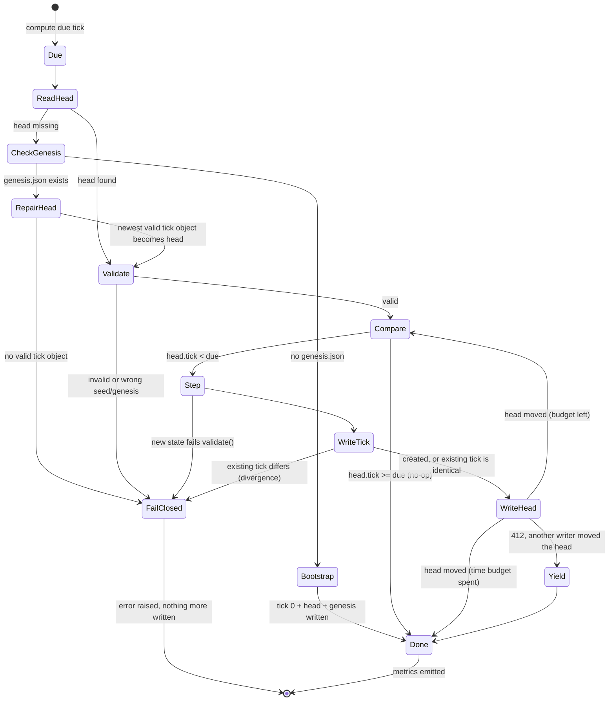

# M1 architecture | Vektor-9 goes live

**Status:** final proposal, revision 2 (2026-11-11). The serverless direction is approved (EventBridge Scheduler, Lambda, S3, CloudFront, CloudWatch, SNS, CDK in Python). The detailed decisions below are proposed and await approval. Nothing is implemented or deployed.
**Companions:** `AWS_READINESS.md` (findings and risks), `AWS_COST_MODEL.md` (cost and monitoring cost), `AWS_M1_BACKLOG.md` (ordered tasks with checkpoints).
**Builds on:** `PROJECT_PLAN.md` section 4, ADR-0002, ADR-0003.

Every AWS behaviour this design relies on is marked **confirmed** (checked against AWS documentation during this review) or **to verify** (checked in the dev deployment, backlog stage 3). Sizes and timings come from the repo; anything else is labelled an estimate.

## 1. Requirements

1. The city advances one tick every 5 minutes whether or not anyone visits.
2. Every tick from 0 to now exists exactly once, in order: no tick is skipped, none is applied twice.
3. State is durable, and the city recovers by itself from missed, late, duplicated or failed runs.
4. Every published snapshot passes `sim.state.validate` and records its schema and the simulation version that produced it.
5. The site, models and snapshots are served over HTTPS from private buckets.
6. Any published tick can be reproduced from the tick before it, years later, from stored artifacts.
7. A stalled, failing or slow city raises an alert; spending raises an alert.
8. Each principal has only the permissions it uses.
9. The whole stack deploys and destroys from CDK in Python, from GitHub Actions without stored keys.

Out of scope for M1: visitor marks (and with them API Gateway, SQS, DynamoDB), the timeline and hourly keyframes (M2), the public control room (M5), a custom domain, WAF.

## 2. Overview

```text
                     ┌─────────────── CloudFront (HTTPS only, OAC, price class 100) ───────────────┐
 Visitor ───────────▶│ /*       → site bucket      web/ (HTML, JS, Three.js, glTF, BIN, JPEG)        │
                     │ /city/*  → data bucket      city/v5/latest.json, city/v5/ticks/NNNNNNNN.json  │
                     └──────────────────────────────────────────────────────────────────────────────┘
                                                        ▲ GET / conditional PUT
 EventBridge Scheduler ─ cron every 5 min (UTC) ─▶ Tick Lambda ─▶ data bucket (city state, history)
   input: scheduled time, execution id, attempt        │  Python 3.13, arm64, 256 MB, 60 s
                                                        ├─▶ CloudWatch Logs + EMF metrics ─▶ alarms ─▶ SNS ─▶ email
                                                        └─  code archived in the releases bucket (deploy time)
 AWS Budgets + Cost Anomaly Detection ─▶ email          GitHub Actions ─ OIDC ─▶ deploy role ─▶ CDK roles
```

| Resource | Configuration |
| --- | --- |
| Tick Lambda | Python 3.13 (matches `.python-version`), arm64, 256 MB (to tune after measuring), timeout 60 s, reserved concurrency 1 when the account quota allows, asynchronous retries 0, maximum event age 300 s. Package: `sim/` + `lambdas/`, no layers, no bundling. |
| Schedule | EventBridge Scheduler, `cron(0/5 * * * ? *)` in UTC, flexible time window off, retry policy: 2 attempts, maximum event age 300 s, no dead-letter queue. |
| Data bucket | Private, Block Public Access, SSE-S3, TLS only, versioning on, `RETAIN` in prod. Written only by the tick. |
| Releases bucket | Private, Block Public Access, SSE-S3, TLS only, versioning on, `RETAIN`, no lifecycle. Written only by the deploy. Never served. |
| Site bucket | Private, Block Public Access, SSE-S3, TLS only, no versioning. Written only by the deploy. |
| CloudFront | One distribution, two origins with Origin Access Control, HTTPS redirect, response headers policy with CSP, cache policies per path (section 7). |
| Alerts | SNS topic with one email subscription (address passed at deploy time, never committed); Budgets and Cost Anomaly Detection email directly. |

## 3. Time and the due tick

- **Genesis** is a UTC instant on a 5-minute boundary, fixed in CDK context together with the **seed**. Tick `n` is due at `genesis + n × 5 min`.
- The schedule uses `cron(0/5 * * * ? *)` rather than `rate(5 minutes)`. A rate schedule starts counting from when it was created, so its invocations would not line up with genesis; cron fires on wall-clock boundaries.
- Scheduler fills the target input with context attributes (**confirmed**): `{"scheduled_time": "<aws.scheduler.scheduled-time>", "execution_id": "<aws.scheduler.execution-id>", "attempt": "<aws.scheduler.attempt-number>"}`.
- The handler computes
  `due = min(floor((scheduled_time − genesis) / 300 s), floor((now − genesis) / 300 s))`.
  The scheduled time says which slot this invocation belongs to; clamping to the clock means no input, crafted or mistaken, can push the city ahead of real time. A manual invocation without `scheduled_time` uses the clock alone.
- Only the handler reads the clock, and only to decide *how many* ticks are due. `step()` stays pure (CLAUDE.md).

## 4. Tick protocol

### 4.1 Objects the tick reads and writes

| Key (data bucket) | Written | Purpose |
| --- | --- | --- |
| `city/genesis.json` | Once, at bootstrap, `If-None-Match: *` | `{seed, genesis, first_schema}`. Ties the bucket to one city; never expires. Guards bootstrap. |
| `city/v5/ticks/NNNNNNNN.json` | Once per tick, `If-None-Match: *` | Immutable history, gzipped. Metadata `sim-version`, `artifact-sha256`. |
| `city/v5/latest.json` | Every tick, `If-Match: <etag>` (create: `If-None-Match: *`) | The head: a copy of the newest tick. Read by visitors and by the next run. |

Conditional writes behave as follows (**confirmed** in the S3 documentation): `If-None-Match: *` writes only if the key does not exist; `If-Match: <etag>` writes only if the object still has that ETag, otherwise `412 Precondition Failed`; a write racing another conditional operation can return `409 ConditionalRequestConflict`, after which the caller re-reads and retries. A conditional `If-Match` put needs both `s3:GetObject` and `s3:PutObject`. Bucket policies can require the conditional headers (condition keys `s3:if-none-match`, `s3:if-match`).

### 4.2 One tick is one commit

Each tick is committed on its own: write the tick object, then move the head to it. There is no batch commit, so a run that dies, times out or is throttled loses at most the tick it was working on, and the next run continues from the last committed head.

Tick objects are compared by their **decompressed JSON**, never by gzip bytes: gzip output can differ between zlib versions even for identical input.

### 4.3 State machine



| State | Action | Outcome |
| --- | --- | --- |
| **Due** | Compute `due` (section 3). If `due < 0`, the city has not started: Done. | |
| **ReadHead** | `GET city/v5/latest.json` (keep the ETag). | Found → Validate; `404` → CheckGenesis. Any other error → raise (the next slot retries). |
| **CheckGenesis** | `GET city/genesis.json`. | Missing → Bootstrap. Present → RepairHead: a city exists, so never start a new one. |
| **Bootstrap** | `state = new_city(seed)`; write genesis, tick 0 and the head, all with `If-None-Match: *`. | A second bootstrap racing the first gets `412` on each object and stops. The next run ticks forward from 0. |
| **RepairHead** | List `city/v5/ticks/`, take the highest tick that validates and matches genesis, create the head from it (`If-None-Match: *`). Emit `RecoveryActions`. | Restores a deleted head without resetting the city. No valid tick → FailClosed (operator restores from versions or replays from the seed). |
| **Validate** | `validate(head)`, plus `head.seed == genesis.seed` and `head.sim ≤ SIM_VERSION`. | Invalid → FailClosed. |
| **Compare** | `head.tick ≥ due` → Done. Otherwise Step. | Duplicate, late and early deliveries all end here with no write. |
| **Step** | `state = step(head, [], tick_rng(head))`; `validate(state)`. | Invalid → FailClosed and nothing published. |
| **WriteTick** | `PUT ticks/{tick}` with `If-None-Match: *`. | `412` → GET it: identical → continue (an earlier run wrote it, then died); different → FailClosed (divergence). `409` → re-read and retry once. |
| **WriteHead** | `PUT latest.json` with `If-Match: etag`; keep the new ETag. | Success → back to Compare while `remaining_time > 15 s` and at most 288 ticks this run. `412` → Yield. |
| **Yield** | Re-read the head. Another writer moved it; its ticks are identical to ours by construction. Emit `RecoveryActions` (conflict). | Stop cleanly; the next slot continues. |
| **FailClosed** | Log the reason, emit `PublishFailures`, raise. | The Errors alarm fires. The head stays on the last good tick. |

Two guards live outside the code:
- The data bucket policy denies `PutObject` on `city/*/ticks/*` without `If-None-Match`, so even faulty code cannot overwrite history.
- Reserved concurrency 1 keeps runs from overlapping in normal operation. Correctness never depends on it: the conditional writes are the real guard. That matters because a new account may have too small a Lambda concurrency quota to reserve anything.

### 4.4 Failure cases

| Situation | What happens | Ticks skipped / duplicated |
| --- | --- | --- |
| Scheduler delivers a slot twice, or Lambda runs a queued copy | Compare: `head.tick ≥ due`, no-op | none / none |
| A delivery arrives after the next slot already ran | Its `due` is already reached: no-op | none / none |
| A slot is missed | The next run is two ticks behind and commits both | none / none |
| Crash or timeout after the tick object, before the head | Next run: WriteTick gets `412`, finds identical content, moves the head | none / none |
| Two runs at once (manual invoke during a run, no reserved concurrency) | Both compute identical ticks; one wins each head write, the other yields | none / none |
| `step()` output fails `validate` | FailClosed; head stays; alarm | city pauses until fixed, then catches up |
| Stored tick differs from recomputed tick | FailClosed (divergence); alarm. Usually a rules change without a version bump (section 6) | none published |
| Head deleted or overwritten by hand | Deleted: RepairHead from history. Overwritten with an invalid object: FailClosed; operator restores the previous version (versioning) | none / none |
| Head and every tick object gone (for example an outage longer than tick retention plus a deleted head) | `genesis.json` still exists, so the run refuses to bootstrap a new city; FailClosed. Operator replays from the seed with `tools/replay.py` and restores the head | none, after replay |
| Seed or genesis changed in CDK context against an existing bucket | Validate: seed/genesis mismatch, FailClosed | none |
| Bad code deploy | Errors alarm; revert and redeploy; catch-up | none / none |
| Region outage | The city pauses and catches up afterwards. Multi-region is out of proportion here | none / none |

### 4.5 Catching up, including far more than 24 missed ticks

The first revision capped catch-up at 24 ticks per run. A fixed cap is the wrong limit: what matters is the time left in the invocation. Four strategies were compared:

| Strategy | How it works | Extra parts | Weaknesses | Verdict |
| --- | --- | --- | --- | --- |
| **R1. Scheduled catch-up with a time budget** | Each scheduled run commits ticks one at a time until it is caught up, 15 s of its 60 s timeout remain, or it has done 288 (one city day). The next slot continues. | None | Very long outages take several slots to clear. | **Recommended** |
| R2. Self-continuing chain | While behind, the handler invokes itself asynchronously before returning. | `lambda:InvokeFunction` on itself; recursion guard | Runaway risk if the stop condition is wrong; competes with scheduled runs; harder to reason about. | Rejected |
| R3. Orchestrated backfill | Step Functions (or a separate backfill function) replays the gap in a loop. | A state machine and its role, logs and alarms | A second code path for the same work; more resources than the problem needs. | Rejected for M1 |
| R4. Skip ahead | Jump the city clock to now and carry on. | Needs an offset recorded somewhere: a schema change | Skips ticks, breaks replay and the tick-to-time mapping. | Rejected |

How long R1 takes depends on the time per tick on Lambda, which is not measured yet. **Estimate:** locally a tick takes about 17 ms of compute (step, validate and serialise), and Lambda at 256 MB has a fraction of a core plus two S3 round trips per tick, so somewhere between 0.15 and 0.5 s per tick. With about 45 s of budget per run that is roughly 90 to 300 ticks per slot, against 1 new tick per slot. **Estimated** catch-up: a one-hour outage clears in the first run; a one-day outage (288 ticks) in one to four runs; a one-week outage (2,016 ticks) in about 7 to 25 runs, that is 35 minutes to two hours. Backlog stage 3 measures the real rate. If it turns out too slow, raise the memory (more CPU) before reconsidering R3.

An operator can also run the same handler code locally (`tools/replay.py --catch-up`) with deploy credentials. It uses the same conditional writes, so it is safe to run alongside the schedule. It is a manual tool, not part of the automatic path.

### 4.6 Timeout and memory

- **Timeout 60 s, time budget 45 s.** The handler checks `context.get_remaining_time_in_millis()` before each tick and stops at 15 s left, so a timeout can only interrupt a single tick in flight, which is safe (section 4.4).
- **Memory 256 MB to start (estimate).** The state is one 2,304-tile dict, about 150 KB as JSON. The Python runtime with `boto3` loaded fits comfortably. Memory mainly buys CPU here; tune it from the measured `Duration` and catch-up rate, not from memory used.
- **No overlap in normal operation:** a run lasts well under a second (estimate) and slots are 300 s apart.

### 4.7 Retry layers

| Layer | What it retries | M1 setting | Why |
| --- | --- | --- | --- |
| SDK (`boto3` standard mode) | One S3 call failing transiently | Default | Cheap, inside the run. |
| Scheduler retry policy | Handing the event to Lambda (the `Invoke` call fails). Scheduler invokes Lambda asynchronously, so function errors never return to it | 2 attempts, maximum event age 300 s, no DLQ | A delivery older than one slot is useless; the next slot catches up. |
| Lambda asynchronous retries | The function failing after it started; also events waiting while concurrency is busy | 0 retries, maximum event age 300 s | The next slot does the same work five minutes later. |
| Application recovery (above) | Missing ticks, partial commits, conflicts | Due-tick calculation, per-tick commit, time-budget catch-up, RepairHead | The only layer that can tell a missed tick from a duplicate. |

Every duplicate the infrastructure layers can create ends in Compare as a no-op, which is why they can be kept short and simple.

### 4.8 Failure-recovery tests (local, no AWS)

The handler talks to storage through a small interface (`get`, `put` with `if_match` / `if_none_match`, `list`). Tests use an in-memory store with the same conditional semantics and fault injection (fail or crash before or after any call). The S3 implementation of the interface is a thin adapter, exercised in the dev deployment.

| # | Test | Expectation |
| --- | --- | --- |
| T1 | Bootstrap on an empty store | genesis, tick 0, head written; second run is a no-op |
| T2 | Two bootstraps racing | One city; the loser stops on `412` |
| T3 | Same scheduled time delivered twice | Second run writes nothing |
| T4 | Late delivery (scheduled time older than head) | No write |
| T5 | Scheduled time in the future or before genesis | Clamped to the clock / no-op |
| T6 | One slot missed | Next run commits two contiguous ticks |
| T7 | 2,016 ticks missed, small time budget | Several runs; every tick 1..due exists exactly once, in order |
| T8 | Crash after tick write, before head write | Next run moves the head without rewriting; content identical |
| T9 | Timeout in the middle of catch-up | Committed ticks kept; next run resumes from the head |
| T10 | Two handlers interleaved on one store | One yields; history identical to a single clean run |
| T11 | Stored tick object differs from the recomputed one | FailClosed, head unchanged, `PublishFailures` emitted |
| T12 | Head invalid | FailClosed, no writes |
| T13 | Head deleted, ticks present | RepairHead to the newest valid tick, never to tick 0 |
| T14 | Head and ticks gone, genesis present | FailClosed, no new city |
| T15 | Seed or genesis in config differs from `genesis.json` | FailClosed |
| T16 | `409 ConditionalRequestConflict` once | Re-read, retry, success |
| T17 | Property test (Hypothesis): random crash points, duplicate and late deliveries over many slots | Final history equals a clean run from the seed, tick for tick |
| T18 | Rules version change mid-history | New ticks carry the new `sim`; older ticks keep theirs |

## 5. Snapshot schema 5 and the simulation version

### 5.1 What each snapshot records

Schema 5 (proposed, ADR-0003 update) adds one top-level field: `"sim": <int>`, the version of the simulation rules that produced this snapshot. `new_city` and `step` set it from `SIM_VERSION` in `sim/rules.py`, and `validate` checks it is a positive integer. Nothing else changes.

Why inside the snapshot and not only as S3 metadata: the snapshot then describes itself wherever it is copied (a local folder, a test fixture, a download) and the replay tool and renderer can read it without the S3 API. Tick objects also carry `sim-version` and `artifact-sha256` as S3 metadata for traceability, but the field in the JSON is the record.

Because nothing is live yet, schema 5 is introduced **before genesis**: the deployed city starts at schema 5 and no migration is needed. The renderer accepts schemas 4 and 5 (it does not read `sim`), so the shared local `snapshots/` folder, which holds schema 4, keeps working.

### 5.2 When the version changes

| Change | `SIM_VERSION` | `SCHEMA` | Effect |
| --- | --- | --- | --- |
| Refactor with identical output | same | same | None. |
| Rule or constant change that can alter any output of `step` or `new_city` | +1 | same | New ticks carry the new `sim`. Old ticks keep theirs. Same storage path, renderer unaffected. |
| Python runtime upgrade (for example 3.13 to 3.14) | +1 unless the golden test proves identical output | same | See 5.3. |
| Snapshot keys, kinds or meaning change | +1 | +1 | New storage path and a migration (5.5). |

A **golden-output test** enforces the first two rows: `tests/golden/sim-v{N}.json` holds the SHA-256 of the canonical JSON at a few fixed (seed, tick) points. Any change that alters output fails the test until `SIM_VERSION` is bumped and a new golden file is added. Rules cannot change silently.

### 5.3 Recovering old versions for replay, without relying on Git

Git history alone does not guarantee that old code still runs: the repo can be rewritten, the code may depend on a Python version that is no longer installed, and a commit hash does not say which interpreter produced the output. So each deployed simulation is archived as an **executable release**:

- At deploy, CDK stores the exact Lambda package (`sim/` + `lambdas/`, zipped, content-addressed by CDK's asset hash) in the **releases bucket** at `sim/v{SIM_VERSION}/{asset-hash}.zip`, with `sim/v{SIM_VERSION}/{asset-hash}.json` = `{sim_version, schema, sha256, python: "3.13", git_commit, built_at}`. Written once, never deleted (versioned, retained, no lifecycle).
- The package is standard library only (`pyproject.toml` has no dependencies), so it needs nothing but a Python interpreter of the recorded minor version.
- **The interpreter matters.** Python guarantees only that `random()` reproduces the same sequence for the same seed across versions. The sim also uses `randint`, `randrange`, `choice` and `sample` (`sim/state.py`, `sim/step.py`), whose algorithms may change between Python versions. Hence the recorded Python minor version, the pinned Lambda runtime (`python3.13`, matching `.python-version`), and the runtime-upgrade row in 5.2.
- The same zip is attached to a GitHub release tagged `sim-v{N}` as a second, public copy. Git commit and tag are recorded for people; the archived zip is what replay runs.

Replay of tick `n` (`tools/replay.py`): read ticks `n−1` and `n`; take `v = n.sim`; fetch a release for `v`, check its SHA-256; run it with the recorded Python minor version; `step(n−1, [], tick_rng(n−1))` must equal `n`. Until M4 there are no marks, so the whole history also replays from the seed. From M4 the marks applied in each tick must be archived with it, or replay stops working.

### 5.4 Frontend compatibility

- The renderer lists the schemas it supports and reads `/city/v{newest supported}/latest.json`. It ignores fields it does not use, such as `sim`.
- A rules-only change never touches the path or the renderer.
- Visitors with an old renderer cached keep reading the schema path that renderer knows, so a schema bump cannot break an open page. At worst that page shows a frozen city until it reloads.

### 5.5 A schema bump after launch (procedure, not needed for M1)

1. Ship a renderer that supports both the old and the new schema.
2. Ship a sim with `SCHEMA + 1`, a pure `migrate(old) → new` and its tests. The first run on the new code reads the old head, migrates it, and writes tick `head + 1` under the new path. Tick numbers continue; `genesis.json` is shared.
3. The old path freezes on its last tick and is kept for history.
4. Later, drop old-schema support from the renderer.

## 6. S3 and CloudFront

### 6.1 Buckets and access

| Check | Decision | How it is verified |
| --- | --- | --- |
| Private access through OAC | Both origins use Origin Access Control (CDK `S3BucketOrigin.withOriginAccessControl`). Bucket policies allow `s3:GetObject` to `cloudfront.amazonaws.com` only with `AWS:SourceArn` = this distribution; the data bucket only for `city/v*/*` (so `city/genesis.json` is never served). Block Public Access on all three buckets. SSE-S3, so no KMS key policy is involved. | Template tests; in dev, a direct S3 URL returns 403 and the CloudFront URL returns 200. |
| Two buckets for site and data (plus releases) | Confirmed. The site deploy prunes its bucket; nothing it does can reach the data or releases buckets, whose writers are only the tick and the deploy's archive step. | Template test: the site deployment's role has no permission on the data bucket. In dev: redeploy the site and check history is intact. |
| Immutable snapshot naming | `city/v{schema}/ticks/{tick:08d}.json`, written once with `If-None-Match: *`, also required by bucket policy. | Template test on the policy; in dev, an unconditional `put-object` to a tick key is denied. |
| Conditional writes for state | Section 4. | Local tests T1 to T17; in dev, the deployed runtime's `boto3` sends `IfMatch` / `IfNoneMatch` successfully (to verify). |

### 6.2 Cache-Control

| Object | `Cache-Control` | Edge behaviour |
| --- | --- | --- |
| `city/v5/ticks/*` | `public, max-age=31536000, immutable` | Cached for a year; never changes. |
| `city/v5/latest.json` | `public, max-age=30` | A visitor sees the newest tick at most about a minute late (30 s at the edge plus 30 s in the browser), against a 5-minute tick. |
| Site files (HTML, JS, glTF, BIN, JPEG) | `public, max-age=0, s-maxage=31536000` | Browsers revalidate on every load (cheap `304` responses, no bytes); the edge keeps files until the deploy invalidates `/*`. This avoids a new `index.html` running with old cached modules after a deploy, since nothing is fingerprinted yet. |
| `city/genesis.json` | not served | The `/city/*` behaviour allows only `v*/` paths. |

**Safe caching of `latest.json`:** the cache policy for `/city/*` ignores query strings, cookies and headers, so `latest.json?x=1` and `latest.json?x=2` are the same cache entry. Nobody can bypass the edge cache to hammer the bucket or inflate request costs. Errors under `/city/*` are cached for 10 s, so a missing head during bootstrap is retried soon.

### 6.3 Content types and compression

CloudFront compresses only responses whose `Content-Type` is on its list, and never a response that already has `Content-Encoding` (**confirmed**). The list covers text types such as HTML, JavaScript and JSON; it does **not** include `model/gltf+json` or `application/octet-stream`. Python's `mimetypes` (used when files are synced to S3) does not know `.gltf` at all (measured: no type returned), so without explicit settings glTF would be stored as a generic binary.

| Extension | Content-Type | Compression | Stored as |
| --- | --- | --- | --- |
| `.html` | `text/html` | CloudFront, automatic | as is |
| `.js` | `text/javascript` | CloudFront, automatic | as is |
| `.gltf` | `model/gltf+json` (set explicitly) | **pre-gzipped at deploy**, `Content-Encoding: gzip` | gzip |
| `.bin` | `application/octet-stream` (set explicitly) | **pre-gzipped at deploy**, `Content-Encoding: gzip` (8.1 MB → 1.7 MB measured) | gzip |
| `.jpg` | `image/jpeg` | none (already compressed) | as is |
| snapshot `.json` | `application/json` | gzipped by the tick, `Content-Encoding: gzip` | gzip |

Deploy mechanics: CDK prepares a staging copy of `web/` at synth time, with `.gltf` and `.bin` gzipped (`mtime=0`, so the asset hash is stable), and uploads it with three `BucketDeployment`s into the site bucket: everything except `.gltf`/`.bin`, then `.gltf`, then `.bin`, each with its own content type, encoding and cache headers. Each prunes only the files its own filter matches. That `aws s3 sync --delete` leaves excluded files alone is **to verify** in dev; the fallback is a single deployment plus a CI step that sets headers with `aws s3 cp --metadata-directive REPLACE`.

All browsers send `Accept-Encoding: gzip`, so serving pre-gzipped files to every client is safe.

### 6.4 Content-Security-Policy

```text
default-src 'none'; script-src 'self' 'sha256-<import map of index.html>' 'sha256-<import map of sample.html>';
style-src 'self' 'sha256-<inline style block>'; img-src 'self' data: blob:; connect-src 'self';
base-uri 'none'; form-action 'none'; frame-ancestors 'none'
```

- The pages start from an inline `<script type="importmap">` and an inline `<style>` (`web/index.html`, `web/sample.html`). Import maps cannot be loaded from a file in every browser, so they are allowed by hash. CDK computes the hashes from the HTML files at synth, so the policy cannot drift from the files, and a template test checks it.
- `img-src blob: data:` covers textures that the glTF loader creates from buffers. `connect-src 'self'` covers `fetch` of snapshots and models and closes `?snap=` to other origins.
- One line blocks a strict policy: `web/src/people.js:1084` builds the crowd panel with `innerHTML` that contains a `style="..."` attribute, which `style-src` without `'unsafe-inline'` blocks. Setting that colour through `element.style` (which CSP allows) fixes it. That is a one-line frontend change, done in the hosting task, not now.
- Plus `Strict-Transport-Security`, `X-Content-Type-Options: nosniff`, `Referrer-Policy: strict-origin-when-cross-origin`, through the same response headers policy.
- Whether every target browser honours a hash on an import map is **to verify** in dev with the browser console open (no CSP violation reports).

### 6.5 Frontend releases and rollback

- A frontend release is a deploy of the site bucket from one commit, followed by an invalidation of `/*`.
- **Rollback** is a redeploy of an earlier commit through the same gated workflow (`workflow_dispatch` with a ref). The site bucket is not versioned: the commit is the version and CDK rebuilds the same files from it.
- The renderer reads only `city/v{schema}/`, so a frontend rollback never touches city data. Rolling back past a schema bump is not supported: the old renderer would read its frozen schema path. That limitation is documented with the bump procedure (5.5).

## 7. Monitoring

### 7.1 Signals

Custom metrics are Embedded Metric Format lines in the tick's log (no CloudWatch API permission needed). Namespace `Vektor9`, dimension `Stage` only.

| Signal | Source | Covers |
| --- | --- | --- |
| `HeadTick` (gauge) | EMF, every run | Last successful simulation tick |
| `TicksPublished` (count) | EMF | Ticks committed by the run (0 on a no-op) |
| `TicksBehind` (gauge) | EMF, `due − head` after the run | Missed or delayed ticks |
| `DeliveryDelaySeconds` (gauge) | EMF, `now − scheduled_time` | Late deliveries by Scheduler or the Lambda queue |
| `PublishFailures` (count) | EMF, reason in the log line | Validation failure, divergence, S3 error |
| `RecoveryActions` (count) | EMF, kind in the log line (catch-up, head repaired, conflict yielded) | Recovery events |
| `Errors`, `Duration`, `Throttles` | Lambda, built in | Lambda errors and duration |
| Scheduler delivery metrics (`AWS/Scheduler`) | Built in (names to verify) | Failed or dropped deliveries |
| Actual and forecast spend | AWS Budgets | Unexpected cost growth |
| Spend pattern | Cost Anomaly Detection (no charge) | Unexpected cost growth by service |

Six custom metrics in total.

### 7.2 Alarms

| Alarm | Condition | Missing data | First deployment? |
| --- | --- | --- | --- |
| **City stalled** | Sum of `TicksPublished` < 1 over three 5-minute periods | Breaching (no data means no ticks) | **Yes** |
| **Tick errors** | Lambda `Errors` ≥ 1 in 2 of 3 periods (covers every FailClosed and crash) | Not breaching | **Yes** |
| **Budget** | Actual at 50 %, 80 %, 100 % and forecast at 100 % of a low monthly limit | n/a | **Yes** |
| City behind | Maximum `TicksBehind` > 2 for three periods | Not breaching | Full M1 |
| Tick slow | Lambda `Duration` maximum > 40 s in 2 of 3 periods (near the time budget) | Not breaching | Full M1 |
| Cost anomaly | Cost Anomaly Detection subscription, email | n/a | Full M1 |

**Minimum for the first deployment:** City stalled, Tick errors and the Budget, all emailing one address, plus the EMF metrics (they are free to emit and needed later). Recovery events are expected self-healing and are not alarmed; they appear in metrics and logs. One CloudWatch dashboard (within the free allowance) shows `HeadTick`, `TicksBehind`, `Duration` and `DeliveryDelaySeconds`.

### 7.3 Logs

Every Lambda gets an explicit log group with a retention period: the tick 30 days; the `BucketDeployment` handler and any other CDK-created function 7 days. A template test fails if any `AWS::Logs::LogGroup` lacks `RetentionInDays` or any function has no explicit log group. Each run writes one structured JSON summary line (due, head before and after, ticks published, duration, outcome) plus EMF.

## 8. IAM

| Principal | Allowed | Scope and conditions |
| --- | --- | --- |
| Tick role | `s3:GetObject`, `s3:PutObject` | `data/city/*` |
| | `s3:ListBucket` | data bucket, `s3:prefix` = `city/` (without it a missing key returns 403, not 404, and bootstrap could not be told from a permission error) |
| | logs | its own log group |
| Scheduler role | `lambda:InvokeFunction` | the tick function; trust `scheduler.amazonaws.com` with `aws:SourceAccount` |
| CloudFront (OAC) | `s3:GetObject` | site bucket; data bucket `city/v*/*`; `AWS:SourceArn` = the distribution |
| Site deployment role (CDK) | write | site bucket only |
| Release archive deployment (CDK) | `s3:PutObject` | releases bucket `sim/*` only, no prune |
| GitHub deploy role | `sts:AssumeRole` | CDK bootstrap roles of this account and region only; trust: GitHub OIDC provider, audience `sts.amazonaws.com`, subject `repo:<owner>/vektor-9:environment:production` |

No stored keys: CI uses OIDC; people use IAM Identity Center with MFA. The deploy role ARN lives in a GitHub repository variable, not in a file, because it contains the account ID. No KMS keys (SSE-S3), no WAF in M1 (static public site, no API; the cost risk is covered by the budget).

## 9. Deploy and destroy

- **Stacks:** `Vektor9Ci` (OIDC provider, deploy role, budget, anomaly monitor), deployed once by hand; `Vektor9-dev` and `Vektor9-prod` (everything else).
- **dev:** `RemovalPolicy.DESTROY` everywhere, deployed by hand from a laptop, destroyed and redeployed to prove reproducibility. The dev data and releases buckets are unversioned so emptying them is one command.
- **prod:** deployed only by CI after a reviewer approves in the GitHub `production` environment; data and releases buckets `RETAIN`; one deploy at a time (concurrency group).
- **CI:** pull requests run lint, tests, `cdk synth` and template tests without AWS credentials (the app uses no context lookups). Pushes to `main` add the gated deploy and a smoke test: fetch `/city/v5/latest.json`, `validate` it, confirm it advances within ten minutes, check headers on `index.html`, one `.gltf` and one `.bin`.

## 10. Well-Architected review

| Pillar | Design choices | Risks | Evidence the project can publish |
| --- | --- | --- | --- |
| Operational excellence | Everything in CDK; template tests enforce the house rules; gated deploys; smoke test; runbook exercised in dev. | One operator, one alert inbox. | CDK code and tests, CI runs, ADRs, runbook. |
| Security | Private buckets behind OAC; TLS only; CSP by hash; per-principal roles scoped to prefixes; OIDC pinned to one repo and environment; no stored keys; no personal data in public objects. | Broad default CDK bootstrap execution policy; CSP mistakes break the page. | Synthesized IAM policies, header checks in CI, IAM Access Analyzer with no findings. |
| Reliability | Due tick from the schedule, one commit per tick, conditional writes, fail closed, genesis guard, time-budget catch-up, versioned data, archived releases. | Single region; catch-up rate unmeasured; correctness depends on determinism (golden test and daily replay check guard it). | Tests T1 to T18, recovery drills D2, replay check history, alarm history. |
| Performance efficiency | Compute sized from measurement; snapshots and models gzipped once; immutable ticks cached for a year. | 11 MB first visit, mostly textures. | `Duration` and catch-up rate; first-visit bytes before and after slimming; `?bench` frame times. |
| Cost optimization | Pay-per-use only; arm64; no NAT, VPC, database or idle compute; lifecycle rules; query strings out of the cache key; budget and anomaly alerts. | Transfer and requests grow with visitors. | The cost model, then the real monthly figure. |
| Sustainability | No idle servers; one short run every five minutes; smaller assets mean less transfer. | Transfer dominates the footprint. | Bytes per visit and GB-seconds per tick, measured. |

## 11. Public documentation

What the project publishes about how it runs must keep implemented features apart from planned ones, and every number must be measured.

| Item | State today |
| --- | --- |
| Architecture diagram in the README, drawn from the deployed stacks, planned parts dashed and labelled | Planned (backlog O6) |
| Infrastructure as code with template tests | Planned (S1, S2, S4) |
| ADRs: 0001 to 0012 exist; 0013 simulation versioning, 0014 tick protocol, plus hosting and pipeline decisions | 12 written, others planned |
| Tests and CI: 22 Python and 56 Node tests and lint on every push; synth, handler and template tests planned | Partly implemented |
| Public control-room page reading a small status object (last tick, ticks behind, duration, uptime) | Planned (M5); M1 emits the metrics |
| CloudWatch evidence: alarm definitions in code, alarm history, metric graphs | Planned (M1) |
| Cost and reliability write-up: this document's failure table and retry layers, the cost model, then real figures | Model written; real figures after go-live |
| Daily public replay check | Planned (O2) |

## 12. Final decisions (for approval)

| # | Decision | Proposed |
| --- | --- | --- |
| D1 | Recovery strategy | R1: scheduled catch-up, one commit per tick, 45 s time budget, at most 288 ticks per run. No skipping. |
| D2 | Tick retention in M1 | 30 days of tick objects; non-current head versions 3 days; `genesis.json` and releases kept forever. Revisit with hourly keyframes in M2. |
| D3 | Seed and genesis | Chosen at the first prod deploy, on a 5-minute boundary, fixed in CDK context. |
| D4 | Region | Your choice; `us-east-1` keeps CloudFront metrics and any future certificate in one region. |
| D5 | Monitoring in M1 | Stalled, errors and budget alarms at the first deploy; behind, slow and anomaly detection before calling M1 done. |
| D6 | Reserved concurrency | 1 when the quota allows; not relied on. |
| D7 | Custom domain | Not in M1. |
| D8 | Simulation version | Schema 5 adds `sim`; `SIM_VERSION` in `sim/rules.py`; golden-output test; introduced before genesis. |
| D9 | Code archive | Releases bucket with each deployed package and its manifest; GitHub release as a second copy. |
| D10 | Compression | Pre-gzip `.gltf` and `.bin` at deploy with explicit content types. |
| D11 | Site caching | Browser revalidates every load; edge cached until the deploy invalidates. Fingerprinted names later. |

The ordered implementation backlog is in `AWS_M1_BACKLOG.md`.
